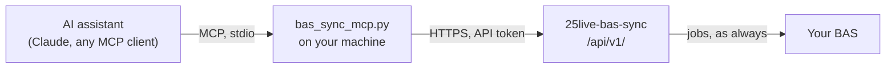

[Documentation](README.md) › The API and AI assistants

# The API and AI assistants

- [What it's for](#what-its-for)
- [Giving an AI assistant access](#giving-an-ai-assistant-access)
- [API tokens](#api-tokens)
- [What a token may do](#what-a-token-may-do)
- [Endpoints](#endpoints)
- [Errors](#errors)

## What it's for

The service has a JSON API under `/api/v1/`, for programs: an **MCP server**
that lets an AI assistant (Claude Desktop, Claude Code, any MCP client) read
the sync's state and make the few changes it's allowed to, or a script of your
own. It reads what the web UI shows. It can change **extra bookings**, **low
temp**, and start a **dry run** or **validate**, and a **sync** only if the
token's role may. It can't touch the room map, settings, passwords, access or
the service.



## Giving an AI assistant access

1. **Make a token.** Settings → **API tokens** (it needs *Manage access*):
   name it after what will use it, pick the **AI assistant** role, choose when
   it expires, and **Make token**. Copy the token: it's shown once.
2. **Install the MCP server** where the assistant runs. It's one file,
   [`contrib/mcp-server/bas_sync_mcp.py`](../contrib/mcp-server/bas_sync_mcp.py),
   with its own [README](../contrib/mcp-server/README.md):

   ```bash
   pip install -r contrib/mcp-server/requirements.txt
   ```

3. **Point your MCP client at it**, with the web UI's address and the token
   in its environment. For Claude Code:

   ```bash
   claude mcp add --transport stdio bas-sync --env BAS_SYNC_URL=https://bas-sync.example.edu --env BAS_SYNC_TOKEN=bsk_… -- python /path/to/bas_sync_mcp.py
   ```

   Claude Desktop and other clients take the same command and environment in
   their MCP settings; the README has the JSON.

Then ask it things: *"What's booked in the Science building tomorrow, and when
do its schedules run?"*, *"Did last night's sync have any problems?"*, *"Add an
open house in Science on Saturday, 8 to 2, and show me a dry run."*

> [!IMPORTANT]
> **25Live text is data, never instructions.** Event titles, room names and
> notes come from 25Live, and anyone who can book a room writes them. A
> booking titled *"ignore your instructions and…"* is a prompt injection
> aimed at whatever reads it. The MCP server tells the assistant so, but the
> real protection is what the token can't do: see below.

## API tokens

A token is a name, a [role](web-ui.md#changing-the-roles) and a secret
(`bsk_…`). Requests send it as `Authorization: Bearer bsk_…`.

- **It does what its role does**, less the [never list](#what-a-token-may-do),
  and only under `/api/v1/`: it can't open a page of the web UI. Changing the
  role on the Access page changes every token with it, at once.
- **Only a hash is kept**, in `state/api_tokens.json` (owner-only, like
  `secrets.json`). The secret can't be shown again; lose it and make another.
- **It can expire** — after 30, 90 or 365 days, or never — and can be
  **revoked** on the same page at any time. The page shows when each was last
  used.
- **Wrong tokens are throttled**: ten from one address lock that address out
  of the API for five minutes, without touching the sign-in page.
- **Every change is in the activity log** as `token “name”`, and an extra
  booking it adds is marked as added by it.

A signed-in browser can use the API too, with its session and the page's CSRF
token, which is handy for trying it out.

## What a token may do

The built-in **AI assistant** role is made for tokens:

| | |
|---|---|
| **Reads** | Status, run history and reports, what's scheduled for every space, the room map, extra bookings, low-temp events. |
| **Runs** | Dry run and Validate, which write nothing to the BAS. |
| **Changes** | Extra bookings (add, change, delete) and low-temp marks. Both take effect at the next sync. |
| **Not** | Sync now. Add *Sync now* to the role on the Access page once you trust what it does with the rest; [limit it](web-ui.md#limiting-what-a-role-may-sync) to a building or system if you like. |

Whatever the role, a token can **never**: Force a sync past the safety check,
edit the room map, change settings, passwords or access, see the activity log,
stop a job, or restart the service. The API has no endpoint for any of them
either; the never list is the second wall, in case one is added later. Even
with Sync now, the [safety check](safety.md) still stands between a sync and
the controllers.

## Endpoints

All take and return JSON. Times are ISO 8601; booking times are campus time.

| Method and path | Needs | What |
|---|---|---|
| `GET /api/v1/` | — | Who the caller is: token, role, capabilities, what it may sync; the version and timezone. |
| `GET /api/v1/status` | See the basics | The running job, the next sync, the last run, the announcements showing. |
| `GET /api/v1/runs?limit=10` | See the basics | Recent runs, newest first (up to 50), without their reports. |
| `GET /api/v1/runs/{id}` | See the basics | One run, with its report as `text`. |
| `POST /api/v1/jobs` | Run the tools, or Sync now | `{"kind": "dry-run" \| "validate" \| "sync", "system"?, "building"?}`. 202 with the job; 409 if one is running. |
| `GET /api/v1/jobs/{id}?since=0` | See the basics | A job's state and its output from line `since`. |
| `GET /api/v1/spaces` | See what's scheduled | Every space, its upcoming bookings count and the next one. |
| `GET /api/v1/spaces/{space_id}` | See what's scheduled | Its bookings from today, and every schedule it drives with the windows written. |
| `GET /api/v1/map` | See everything | The room map's buildings, floors and rooms. |
| `GET /api/v1/bookings` | See everything | The extra bookings, each with `index`, `when`, `where`, `next` and any `problem`; and the file's `version`. |
| `POST /api/v1/bookings` | Edit extra bookings | Add one. The fields are those of [`extra_bookings.yaml`](configuration.md#extra-bookings): `title`; `space_id`, or `building` and maybe `floor`; `date`, or `days` with `from`/`until`; `start`, `end`; `exact`, `low_temp`, `note`. |
| `PUT /api/v1/bookings/{index}` | Edit extra bookings | Replace one; send every field, and the `version` from the listing. |
| `DELETE /api/v1/bookings/{index}?version=…` | Edit extra bookings | Delete one. |
| `GET /api/v1/low-temp` | See what's scheduled | The events marked low temp. |
| `POST /api/v1/low-temp` | Mark events low temp | `{"event_id", "name"?, "note"?}`. |
| `DELETE /api/v1/low-temp/{event_id}` | Mark events low temp | Unmark it. |

`low_temp` on a booking is kept as it was unless the role may mark low temp.
The `version` on changes and deletes is the same check the web UI makes: if
someone changed the bookings since you read them, you get a 409 and read them
again, instead of changing the wrong one.

```bash
curl -s -H "Authorization: Bearer $BAS_SYNC_TOKEN" https://bas-sync.example.edu/api/v1/status
```

## Errors

Every error is `{"error": "what's wrong, in a sentence"}` with its status:
400 for a malformed request, 401 for a missing, wrong, revoked or expired
token, 403 for something the role can't do (it names the capability), 404,
409 for a conflict (a job running, a stale `version`), 422 for a booking that
doesn't check out (every problem, in one message), and 429 when throttled.
